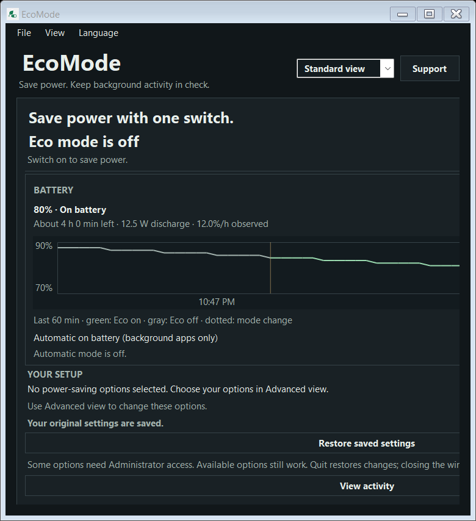

# EcoMode

⚡ **EcoMode** is a lightweight Windows utility that helps reduce power consumption and improve efficiency by applying smart system tweaks and process management rules.



## ✨ Features

* **One-click Eco Mode toggle**: enable power-saving with *Eco ON* and restore your saved original settings with *Eco OFF*.
* **Original settings backup**: save a baseline and restore it at any time, including after restarting EcoMode.
* **Windows power plan tweaks**: automatically adjusts *Energy Performance Preference (EPP)* and *Boost* settings.
* **Browser policies**: applies registry policies for Microsoft Edge and Google Chrome (hardware acceleration off, battery saver/efficiency mode on).
* **Per-app GPU preferences**: configure applications to use *integrated GPU (power-saving)* or *discrete GPU (performance)*.
* **EcoQoS (Quality of Service)**: throttle background processes while keeping the active foreground app boosted.
* **Configurable bypass list**: define which processes should never be throttled.
* **Tray support**: runs in the background, minimizes to system tray instead of closing.
* **Import / export / reset profiles**: easily back up or share your configuration.
* **Built-in presets**: start with Balanced, Battery Saver, Gaming, Development, Creative Work, or Video Calls, then customize the app and bypass lists.
* **Utility-style interface**: dark panels, a clear Eco status, grouped controls, and a compact activity log. Colors and reusable control styles live in `UtilityTheme.cs`; the window layout lives in `MainForm.Layout.cs`.
* **Activity log**: console-like log viewer with color-coded log levels.

## 📥 Installation

The installer and portable ZIP include the .NET runtime. **Users do not need to install .NET 10 or the .NET Desktop Runtime.** The .NET 10 SDK is needed only to build EcoMode from source.

1. Download the latest installer from the [Releases](../../releases) page.
2. Run the setup — EcoMode will be installed with Start Menu and system tray support.
3. Launch EcoMode from the Start Menu or tray icon.

*(Installer built with Inno Setup — no external dependencies needed.)*

## 🚀 Usage

* When started without Administrator rights, EcoMode offers to restart as Administrator before opening the window. Choose **Yes** to open the Windows elevation prompt, or **No** to continue in standard mode. Canceling the Windows prompt also continues in standard mode. Already elevated launches skip this confirmation.
* Click **Eco ON** to enable Eco Mode.
* On the first **Eco ON**, accept the prompt to save your original settings. Choosing **No** leaves Eco Mode off.
* Click **Save originals** to save a new baseline for the selected options and configured GPU apps. Restore pending EcoMode changes first; replacing an existing baseline requires confirmation.
* Click **Eco OFF** to undo the settings EcoMode applied, regardless of the currently selected options or app list.
* Click **Restore originals** to reapply the entire saved baseline whenever needed.
* Use the **check boxes** to control which tweaks are applied (Power Plan, Edge/Chrome policies, GPU prefs, EcoQoS).
* Use **Add app** to add apps for GPU preference management.
* Add process names to the **Bypass list** if they should never be throttled.
* Right-click the **tray icon** for quick Save / Quit options.

### Preset profiles

Choose a **Preset profile** and click **Load**. Confirming replaces and saves the current profile, including any unsaved edits. Review the options, GPU paths and bypass list, then click **Eco ON** to apply it. Use **Eco OFF** and finish restoring any pending changes before switching presets. Loading a preset preserves your saved original settings.

| Preset | Enabled changes | Bypass list focus |
| --- | --- | --- |
| Balanced | Background EcoQoS and power-saving GPU preferences for Edge/Chrome | Common calls, audio and OBS |
| Battery Saver | Power-plan EPP/boost, Edge/Chrome policies, browser GPU preferences and EcoQoS | Common calls and audio |
| Gaming | Background EcoQoS | Launchers, Discord, OBS and overlay tools |
| Development | Background EcoQoS | IDEs, compilers, build tools, runtimes, terminals and container hosts |
| Creative Work | Background EcoQoS | Editors, renderers, encoders, recording and audio tools |
| Video Calls | Background EcoQoS | Meeting apps, browsers, WebView, OBS and audio |

Battery Saver uses the existing Eco power values (EPP 85 AC / 90 DC, CPU boost disabled) and disables Edge/Chrome hardware acceleration. It can reduce performance on demanding tasks. Power-plan and browser policy changes require Administrator privileges; browser policies need a browser restart.

Presets are starting points. **Add the executable names of your games, renderers, build tools or meeting apps to the bypass list**, especially if they must run at full speed while in the background. Foreground applications retain their original priority; the built-in system bypass list also remains active. GPU paths cover common installation locations, and missing files are skipped; use **Add app** for other locations. Gaming, Development, Creative Work and Video Calls leave power-plan, browser and GPU settings untouched.

The same presets are available as importable JSON files in [`profiles/`](profiles/) and are embedded in the app, so the picker also works when only the executable is copied. Creative Work uses the existing `production.json` filename. Edited presets can be saved and exported like any other profile.

User GPU originals are stored separately from profiles at `%APPDATA%\EcoMode\original-settings.json`. Machine-wide power plan and browser policy originals are kept in the protected 64-bit registry value `HKLM\SOFTWARE\ToolsLib\EcoMode\OriginalSettingsV1`, shared across Windows accounts and sessions. Only one EcoMode instance can run on a machine at a time. An administrator launch migrates machine entries from older per-user snapshots before applying new changes.

Snapshots preserve the original AC/DC EPP and boost values for each affected power plan and the exact supported policy/GPU values. Values that did not originally exist are removed on restore. Adding options, GPU apps, or another active power plan extends the appropriate snapshot before those settings are changed. Repeated Eco ON does not overwrite saved originals. GPU changes preserve unrelated preference fields. Unknown snapshot destinations, duplicate entries, and invalid value types/ranges are rejected before restoration.

Run EcoMode as Administrator to capture, apply, or restore system power settings and browser policies. Without elevation, user GPU preferences and accessible processes are still supported. Failed restores remain pending for retry, including after restarting the app. Power values are restored to their original plans without switching away from the currently active plan. Browser policy changes require a browser restart.

**Quit** shows a warning that EcoMode will restore the power plan settings, browser policies, GPU preferences, and original process priority/EcoQoS state it changed. Choose **OK** to restore and exit, or **Cancel** to keep running. Restoration includes processes subsequently added to the bypass list and settings whose options were subsequently unchecked. If system restoration needs elevation, an unelevated instance offers a recovery exit after process cleanup: the saved originals remain, and you can reopen EcoMode as Administrator to finish restoration. Other restore failures keep the app open with a warning. Journal update failures do not prevent best-effort rollback; unchanged pending records can be retried on the next launch.

Closing the window with **X** still keeps EcoMode running in the tray. Windows shutdown attempts restoration without showing a modal warning. Cleanup cannot run if the process is forcibly terminated. Processes whose original throttling state cannot be queried are left unchanged. Uninstall preserves profiles and both restore journals so pending settings can still be recovered after reinstalling. Imported profiles are validated before saving; null/blank entries are normalized, and malformed startup profiles fall back to defaults without blocking the recovery UI.

## 🛠 Tech

* **C# (.NET 10 LTS WinForms)**
* **P/Invoke (Win32 APIs)** for EcoQoS and power throttling
* **Inno Setup** for installer packaging

## Build and Run (development)

Requires Windows and the .NET 10 SDK version specified in `global.json`. Compatible patches in the same SDK feature band can be used locally when that exact version is unavailable. CI and release workflows install the specified version to keep SDK selection reproducible.

```
dotnet build
dotnet run
```

Run the regression checks on Windows with:

```
dotnet run --project tests/EcoMode.RegressionTests.csproj
```

The checks use temporary snapshot files, disposable registry keys, and dedicated child processes/windows. Native power writes are exercised on a duplicated inactive plan, which is restored and deleted; the active plan is left unchanged. The form is rendered offscreen to check the button layout. Pass `-- --skip-power-read` on hosted VMs to omit the hardware-dependent power read/write checks. [CI](.github/workflows/ci.yml) runs the remaining checks and release-script tests on branch pushes and pull requests with read-only repository permissions.

## Deployment

Build the standalone Windows x64 executable with the checked-in publish profile:

```powershell
dotnet publish ecomode.csproj -c Release -r win-x64 -p:PublishProfile=Standalone
```

The output is `artifacts/standalone/win-x64/ecomode.exe`. This single executable bundles the app, .NET runtime, Windows Forms libraries, native runtime libraries, and built-in presets. It can be copied to another Windows x64 PC without installing .NET. Native libraries are extracted automatically when it starts.

In Visual Studio, choose **Publish → Standalone** with the **Release** configuration. The Inno Setup script also uses this standalone output by default. The automated release script uses the same profile to build the portable ZIP and installer.

Files directly under `bin/Debug/` or `bin/Release/` are development builds and can still require an installed runtime. Distribute the published executable or the release packages.

## Automated releases

Push a version tag such as `v1.2.3` (or `1.2.3`) to run [the release workflow](.github/workflows/release.yml). Prerelease tags such as `v1.2.3-rc.1` are supported. The workflow checks the tag, runs regression checks, and produces:

* `EcoMode-1.2.3-win-x64.zip`: portable, self-contained app with profiles and documentation.
* `EcoMode-1.2.3-win-x64-setup.exe`: self-contained Inno Setup installer.
* `EcoMode-1.2.3-win-x64-SHA256SUMS.txt`: SHA-256 checksums for both packages.

The tag determines the app version, Windows file version, installer version, and filenames. The workflow creates a **draft release** with the packages attached. Review it and publish it when ready. Publishing a release directly also triggers the build for its tag. Existing complete published packages are preserved when the publish event triggers a second run; draft or incomplete mutable releases can be retried. If immutable releases are enabled, let the tag build finish attaching all packages before publishing the draft.

Packages are also available as workflow artifacts for 30 days. Uploads use the built-in `GITHUB_TOKEN` with `contents: write`; no personal access token is needed. Binaries are unsigned unless code signing is configured separately.

The workflow uses the .NET 10 SDK specified in `global.json`, Windows Server 2025, and Inno Setup 7.1.0. GitHub actions are pinned to verified release commits, and [Dependabot](.github/dependabot.yml) checks weekly for updates. Hardware-dependent power-plan read/write checks are skipped on hosted VMs; the remaining process, registry, snapshot, and UI regression checks still run.

To build the same packages locally with PowerShell 7 and an installed Inno Setup compiler:

```powershell
./scripts/Build-Release.ps1 -Version 1.2.3 -IsccPath 'C:\Program Files\Inno Setup 7\ISCC.exe'
```

Output is written to `artifacts/release/`. Test version handling and publication logic without contacting GitHub with `./tests/ReleaseScripts.Tests.ps1`.

## Code signing

Sign your binaries with a code signing certificate to ensure integrity and authenticity.

```
signtool.exe sign /f "path\to\your\certificate.pfx" /p "your_certificate_password" EcoModeSetup.exe
```

## Notes & tweaks

Tuning values: Eco EPP/Boost values are defined in `WindowsSystemSettings.GetTargets`. Eco OFF restores the saved values instead of applying fixed performance defaults.

## 🙏 Thanks

This project was inspired by and builds upon ideas from
[**EnergyStar by imbushuo**](https://github.com/imbushuo/EnergyStar).
Big thanks for making their work available to the community! 💚

## 📜 License

This project is licensed under the [CC BY-NC-ND 4.0 License](LICENSE).

You are free to share the software for non-commercial use **as-is** with attribution.  
You may not modify, rebrand, or use the name **EcoMode** for derivative works.  
